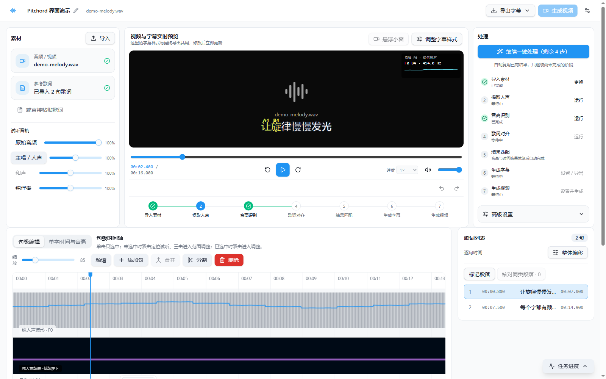
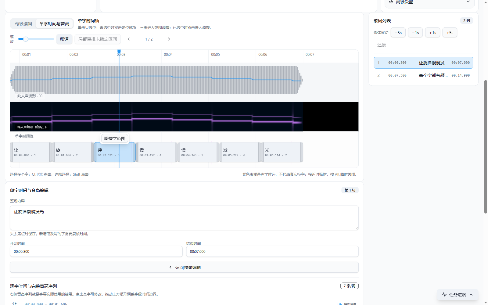

# Pitchord

在练习歌曲的过程中，我们通常对每一句歌词的音高很感兴趣，目前在bilibili生产这样音高标注视频的创作者们效率通常不高，这个工具是为了提高他们的效率，借助一定的工具的算法生成一个大概的音高标注版本，并提供较为直观的界面和便捷的操作来让使用者人工检验并修正结果。
Pitchord 是一款 Windows 本地桌面工具，用来把歌曲音频或视频与参考歌词对齐，校对每个字的时间，并制作随音高变化的动态字幕。自动分析给出初稿；波形、频谱、音高曲线和实时预览帮助你快速找到并修正不准的字界。

**[下载最新正式版](https://github.com/Fanghongzhe/Pitchord/releases/latest)** · [查看所有版本](https://github.com/Fanghongzhe/Pitchord/releases)



> 画面取自实际运行的 Pitchord v1.0.0；歌曲和歌词为演示数据，不代表真实歌曲的自动识别结果。

## 能做什么

- 导入音频或视频及 LRC／纯文本歌词；自动保存工程，也可从最近项目直接继续编辑。
- 分离人声与伴奏，并可选用 BS-RoFormer Karaoke 进一步分离主唱与和声。模型按需准备，不随安装包提供。
- 从选定的人声轨提取连续音高，用参考歌词生成句级、逐字时间建议；分析结果可切换，人工修改不会要求重新做人声分离或音高识别。
- 在同一时间轴查看人声波形、频谱、F0 曲线和逐字区间。拖动字界时可吸附声学候选，锁定已确认的边界，并按异常提示优先复核可疑位置。
- 一边试听一边查看动态字幕：字色映射到可选或自定义的音高色带，当前字由下方强调点标示。可调整点的大小、位置及字幕样式。
- 导出句级 LRC/SRT、逐字音高 JSON 或 ASS；视频工程还可导出嵌入字幕的 MP4。



## 下载与首次使用

1. 在[最新正式版页面](https://github.com/Fanghongzhe/Pitchord/releases/latest)下载 `Pitchord-1.0.0-windows-x64.zip`。
2. 将压缩包中的 `Pitchord` 文件夹完整解压到可写的本地位置，双击 `Pitchord.exe`。程序本体无需传统安装。
3. 首次需要音频分析时，按“首次准备分析环境”的提示选择推荐配置。Pitchord 会准备独立的 Python、分析依赖和所选模型；这一过程需要网络、磁盘空间和时间。也可以选择已有的 Python 3.10–3.12 环境。
4. 新建工程，导入歌曲和歌词。建议按“人声分离 → 连续音高 → 歌词时间戳匹配 → 逐字复核 → 字幕导出”的顺序工作；也可使用界面中的一键继续处理。

分析环境默认放在程序同目录的 `environment`，也可以在首次设置时选择其他磁盘。推荐的人声分离模型和歌词对齐模型按需下载；去和声模型是可选项。没有 NVIDIA 显卡也可使用 CPU，只是部分分析任务会更慢。

> 自动对齐和声学候选都只是建议。长音、连读、弱辅音、重复歌词等场景仍应试听复核；音高跳变不能单独证明换字。

## 工程文件与隐私

工程保存在新建时选择的文件夹。原媒体、人声分析结果和导出文件分别存于工程内的 `media`、`analysis`、`exports`；歌词及其历史版本存于 `lyrics`。Pitchord 在本机处理媒体，不会上传歌曲或歌词；首次准备环境和模型时会联网下载相应组件。

旧工程可以在首页从最近项目直接打开，也可以从文件夹打开。删除程序目录不会自动删除另存的工程；删除整个便携程序目录则会移除其中默认存放的分析环境。若环境放在其他位置，可在“设置 → 存储与环境”中查看和清理。

## 开发与构建

开发环境需要 Node.js 20.19+ 或 22.12+ 和 pnpm：

```bash
pnpm install
pnpm desktop:start
```

常用检查与 Windows 便携包构建：

```bash
pnpm test
pnpm build
pnpm desktop:package
```

分析架构见 [docs/analysis-architecture.md](docs/analysis-architecture.md)，界面与逐字标注约定见 [design.md](design.md)。第三方组件说明见 [THIRD_PARTY_NOTICES.md](THIRD_PARTY_NOTICES.md)。
